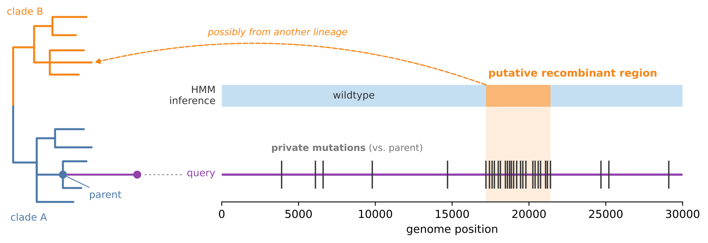

# 8. Recombination detection

Recombination produces a genome assembled from segments of two or more distinct parents. Against the inferred parent, such a sequence has a characteristic pattern: one region matches closely (few mutations), another diverges strongly (many mutations), because it descends from a different lineage.

Nextclade detects these diverged regions and flags them as **putative recombinant** intervals. It uses a probabilistic model of the density of [private mutations](05-mutation-calling.md#private-mutations), the differences from the inferred parent, along the genome.

Recombination detection does not suit every pathogen, so it runs only for datasets that enable it with `recombination.enabled` in the [pathogen configuration](../input-files/05-pathogen-config.md#recombination). In Nextclade CLI, `--with-recombination` and `--without-recombination` override the dataset setting.

## Model

Nextclade uses a two-state [hidden Markov model](https://en.wikipedia.org/wiki/Hidden_Markov_model) decoded with the [Viterbi algorithm](https://en.wikipedia.org/wiki/Viterbi_algorithm). The hidden states represent the ancestry of the sequence at each reference position:

- **wildtype**: the sequence matches its parent (nearest node on the reference tree), with sparse mutations.
- **recombinant**: the sequence diverges from its parent, and mutations are dense.

Each reference position yields one observation relative to the parent:

- **mutated**: a private substitution (difference from parent, including reversions).
- **not mutated**: a covered position identical to the parent.
- **missing**: no comparable information (deletion, `N`, ambiguous character, or position outside the aligned region).

Each maximal run of the recombinant state becomes one candidate interval, trimmed to start and end on a covered position. The candidates then go through the [checks of the calls](#checks-of-the-calls).

Based on the [`recomb_inference`](https://github.com/mmolari/recomb_inference) prototype and Nextclade issue [#1768](https://github.com/nextstrain/nextclade/issues/1768). See also the [algorithm notes](https://github.com/mmolari/recomb_inference/blob/main/notes/n01_algorithm.typ) and the [prototype implementation](https://github.com/mmolari/recomb_inference/blob/main/code/recomb_inference/viterbi_recombination.py).

## Parameters

Three dataset-specific parameters control the sensitivity of the detection:

- `gamma`: probability of **switching state** between adjacent positions. It sets how strongly the model resists a switch between the wildtype and recombinant states: a lower `gamma` requires more mutations to open a recombinant interval.
- `muW`: probability of observing a **private mutation in the wildtype state**, which is the expected density of private mutations in a non-recombinant sequence. It should be close to the typical length of a non-recombinant terminal branch in the reference tree.
- `muR`: probability of observing a **private mutation in the recombinant state**, which is the expected density of private mutations inside a recombinant region. It should be close to the typical pairwise distance between sequences of different clades, and much higher than `muW`.

Each parameter can be set in the [pathogen configuration](../input-files/05-pathogen-config.md). Nextclade estimates each unset parameter from the dataset:

- `gamma` defaults to `0.01 / L` (`L` = reference length): in many viral species recombinants are rare, so the expected switch rate is far below one per genome. A single state switch then costs about `ln(100 L)` in log-likelihood, so a recombinant interval opens only when its excess mutations outweigh that cost, and short dense stretches get no call.
- `muW`: mean terminal branch length of the reference tree (substitutions per site).
- `muR`: median pairwise substitution distance between leaves of different clades (per site).

We recommend that dataset maintainers tune the parameters to the diversity of the dataset and pathogen on representative sequences, instead of relying on the defaults.

The parameters are reported once per run: in the log, and in the `recombinationParams` field of `nextclade.json`.

## Checks of the calls

To reduce false positives, Nextclade checks the intervals that the model detects before it reports them, and reports a call only when the evidence is strong.

First, Nextclade drops each candidate interval that is too short, or that has too many missing sites in its span (`N` or other ambiguous nucleotides, deletions, masked or unaligned sites). The checks run in this order:

- The interval is dropped when the fraction of missing sites in its span is above `maxRegionMissingFraction` (default `0.5`).
- Otherwise it is dropped when its span is below `minRegionLength` nucleotides (default `50`).

Then Nextclade checks that the rest of the sequence is consistent with its placement on the tree: most private mutations should lie in the recombinant intervals, and the rest of the sequence should have a low mutation density. The checks run in this order:

1. **Coverage**: the total span of the recombinant intervals divided by the span of the aligned region is below `maxRecombinantFraction` (default `2/3`), so that enough of the sequence remains as wildtype.
2. **Low divergence**: the rest of the sequence must still fit the tree, and not contain too many private mutations. Nextclade masks the recombinant intervals, and computes the weighted total of the [private mutations QC rule](06-quality-control.md) on the rest of the sequence, with the weights of `qc.privateMutations`. The check fails when the weighted total is at least `(typical + cutoff) * Lm / L`, where `Lm` is the number of covered sites outside the intervals and `L` is the reference length. Equivalently, the private mutations QC score, with `typical` and `cutoff` both scaled by `Lm / L`, reaches 100, so a shorter rest gets a stricter threshold. Because this check uses the `qc.privateMutations` rule, detection requires that rule in the dataset.

Nextclade reports the intervals of a sequence only when all checks pass.

## Output

Per sequence with a call: list of putative recombinant intervals (reference coordinates), number of intervals, total length, and longest interval length. A sequence without a call has empty recombination fields. See [output columns](../output-files/04-results-tsv.md) and the [results table](../nextclade-web/analysis-results-table.md).

## Limitations

- The algorithm identifies _where_ a sequence diverges from its parent, but not the donor lineages.
- Only recombination between sufficiently distant clades is detected. Recombination between closely related lineages produces few distinguishing mutations and may go undetected.
- Dense sequencing artifacts can resemble short recombinant regions, and can be flagged as recombinant.
- If some regions of the genome evolve faster than the rest, they may be flagged as recombinant. Model parameters should be tuned to the dataset to avoid this.
