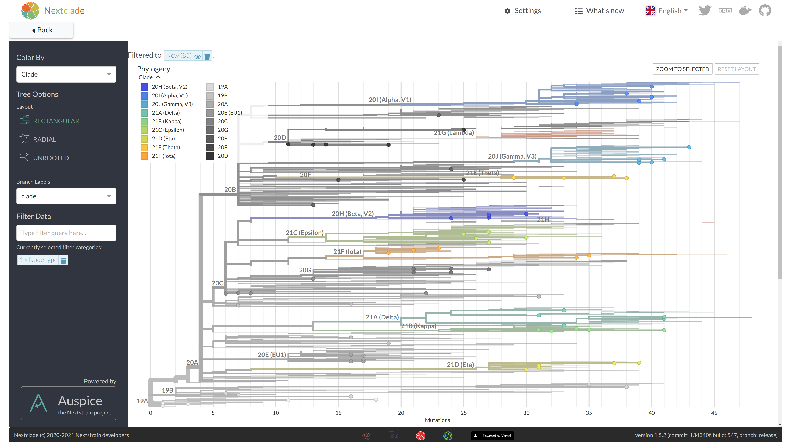
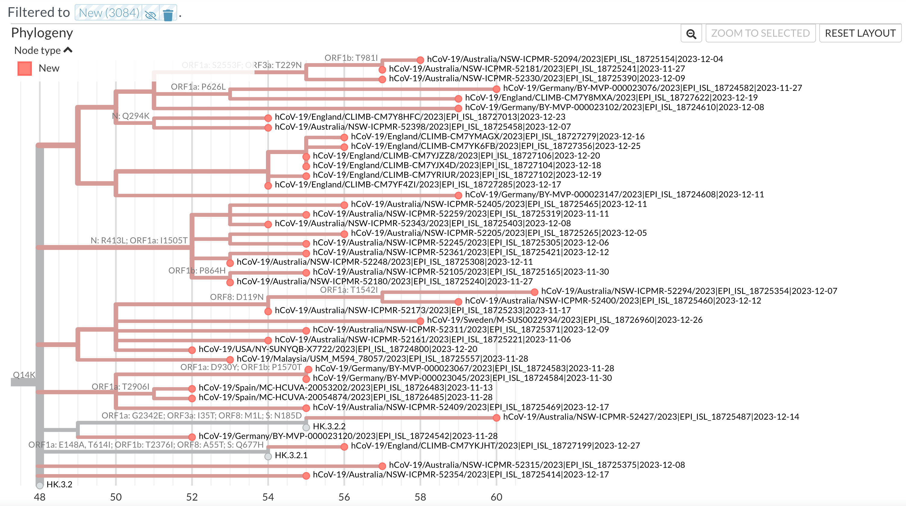
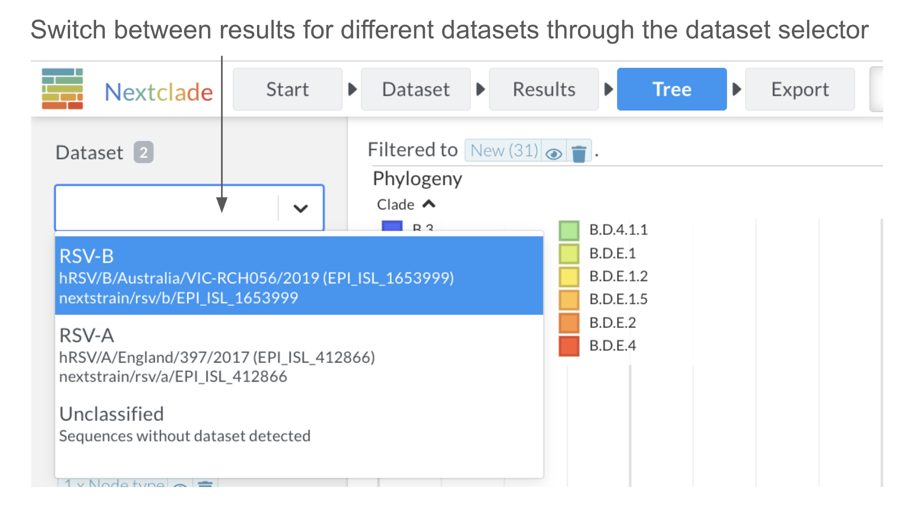

## Phylogenetic tree view

In order to assign clades to sequences, Nextclade [places](../algorithm/03-phylogenetic-placement.md) all new sequences on a reference tree. You can view the resulting tree by clicking on the tree tab at the top left.

The tree is visualized by [Nextstrain Auspice](https://docs.nextstrain.org/projects/auspice/en/stable/). By default, only your uploaded sequences are highlighted.

Nextclade runs a greedy parsimony tree builder on user provided sequences. This means that approximate ancestral relationships between your sequences are visible on the tree. Given the simplicity of the tree builder, the tree is not guaranteed to be optimal. In the screenshot below, all but the 3 grey sequences are user provided. Nextclade has grouped related user provided sequences into clusters, based on shared mutations.

For a more accurate tree including your sequences, you can use [Usher](https://genome.ucsc.edu/cgi-bin/hgPhyloPlace), which works out of the box with SARS-CoV-2, hMPXV, RSV-A, and RSV-B (as of January 2024).

### Sidebar controls

The sidebar on the left of the tree holds the Auspice controls that apply to the tree of a Nextclade analysis:

- **Color By** and **Filter Data**: color the tree and filter its tips by clade, QC status, node type, and the other attributes of the dataset
- **Add metadata**: color and filter the tree by your own data, see [Your metadata on the tree](#your-metadata-on-the-tree)
- **Layout**, **Focus on selected**, **Branch Labels**, and **Tip Labels**: arrange and label the tree
- **Explode Tree By**: split the tree into subtrees where an attribute changes along a branch, for example one subtree per clade
- **Map**: show or hide the map of the coordinates that you add to the tree, see [Map](#map)
- **Entropy**: show or hide the diversity chart of the genome below the tree
- **Display**: while the map is shown, show the tree and the map side by side (**grid**) or one below the other (**full**)

The date range, animation, and frequency controls of Auspice are not available, because the sequences that Nextclade places on the tree have no sampling date.

The panels have the sizes that Auspice gives them on nextstrain.org, so the top of the next panel, such as the diversity chart, shows below the tree. Scroll down to see it in full. On windows of 780 pixels or narrower, the sidebar opens over the tree, darkens it, and closes with the tab on its edge, and the row with the filters and the download buttons moves above the tree.

The tree keeps its coloring, filters, zoom, and the other settings of the view while you visit other pages, until the next analysis.

### Your metadata on the tree

Click **Add metadata** in the sidebar, or drop files on the tree, to add the columns of CSV or TSV files to the tree as colorings and filters. The first column of a file holds the sequence names, as in the input FASTA file, and each other column becomes a coloring by its values, for example the sampling site of each sequence. Columns named `date`, `num_date`, `year` or `month` are skipped, because the tree page has no time axis. Columns named `latitude` and `longitude` place the sequences on a map, see [Map](#map). Node-data JSON files of Augur also work. The data stays in your browser.

Excel files are not read: save the sheet as a CSV or TSV file and add that file.

Shift-click a value in the legend of the tree to change the colors of the current coloring, for example for a figure.

### Map

When added metadata has `latitude` and `longitude` columns, the tree page shows a map below the tree, with a circle at each location. The circles show the colors of the sequences at that location, and their size shows the number of sequences. Samples at different coordinates stay apart, and rows with empty coordinates are skipped. The **Map** section of the sidebar turns the map off and on.

The map draws the country outlines, borders and names of [Natural Earth](https://www.naturalearthdata.com/) 5.1.2. Nextclade Web serves these files itself, so the map sends no request to another server. The map needs WebGL. In a browser without WebGL, Nextclade Web tells you that it cannot draw the map.

### Downloads

The buttons above the tree download:

- **SVG**: a figure of the tree, and of the map and the diversity chart, if shown, as on screen. The text below the figure names the dataset, the Nextclade version, how many tips are shown, and the publications to cite
- **JSON** and **NWK**: the tree with your sequences placed on it, in Auspice JSON or Newick format. These are the same files as on the Export page, which offers all other output files of the analysis

On narrow screens these downloads are in the **Download** menu.

### Multi-dataset mode

In multi-dataset mode, you can switch between datasets through the dataset selector on the top left.

