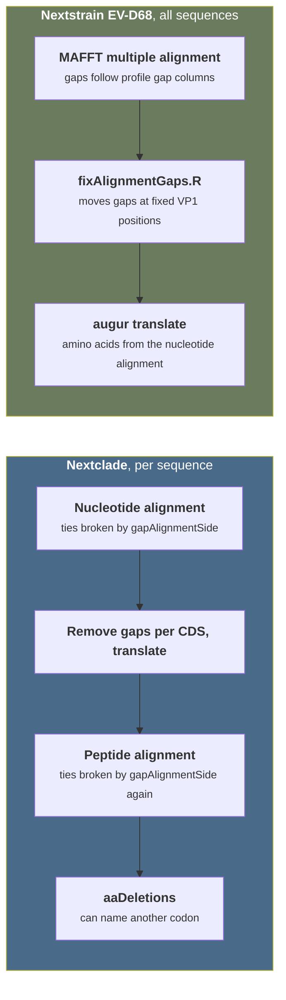
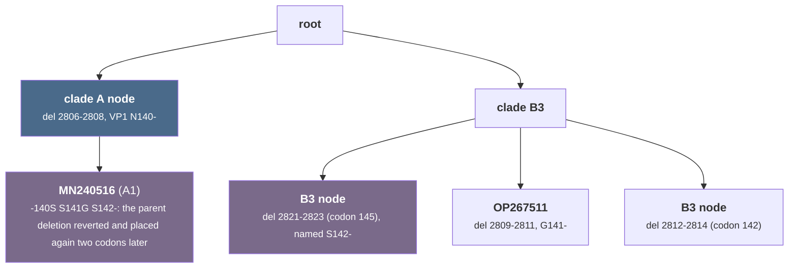
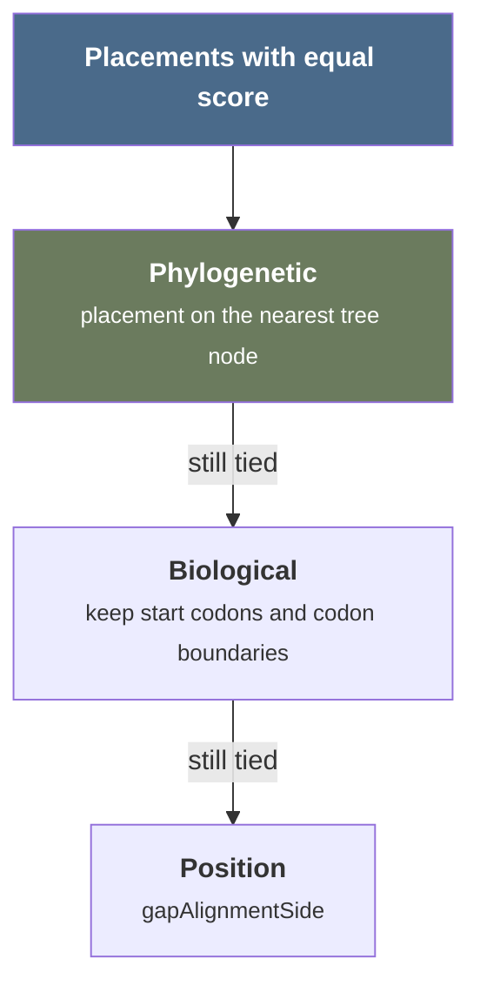

# Placement and naming of indels in repeats

An indel inside a repeat has several placements with the same alignment score. Nextclade picks one placement per sequence with a fixed rule, so the same ancestral event can get different names in different sequences, and amino acid indels can contradict the nucleotide indel. This report measures the problem on the EV-D68 VP1 DE-loop, describes how other tools and standards handle it, and lists directions for Nextclade. None of the directions is decided.




## Summary

- **No placement is correct by itself**: every placement with the same score explains the sequence equally well, so every tool applies a convention. The defect in Nextclade is inconsistency: one event gets several names, and amino acid names can point to another codon than the nucleotide deletion
- **Nextstrain's EV-D68 placement is a manual fix**: the Nextstrain EV-D68 build aligns with MAFFT and then moves DE-loop gaps onto codon boundaries with a script at fixed positions, whose comment says it "should be replaced by a codon-aware alignment method" [[src](https://github.com/nextstrain/enterovirus_d68/blob/b135b964ca7928556d4c193a5891c6e454296565/scripts/fixAlignmentGaps.R)]
- **Standards make the change unique**: a deletion next to a substitution is one <a id="gloss-use-1"></a>delins <sup>[1](#gloss-1)</sup>, which has one name. For a pure indel in a repeat, NCBI SPDI and GA4GH VRS represent the whole <a id="gloss-use-2"></a>ambiguity window <sup>[2](#gloss-2)</sup>
- **The literature places indels as events on a tree**: phylogeny-aware aligners and indel-aware ancestral reconstruction treat an indel as one event on one branch, not as a per-sequence choice

## Problem: EV-D68 VP1 DE-loop

Measurements with Nextclade 3.25.0 (2026-10-13) on 1,195 EV-D68 genomes from GenBank, with the dataset `enpen/enterovirus/ev-d68` of `nextclade_data` at `a6f7bcef`. The dataset sets `gapAlignmentSide` to `right` [[data](https://github.com/nextstrain/nextclade_data/blob/a6f7bcefac9f96c4ab2db5968699c5dfa412e506/data/enpen/enterovirus/ev-d68/pathogen.json#L28)], and VP1 is the CDS 2389-3315 [[data](https://github.com/nextstrain/nextclade_data/blob/a6f7bcefac9f96c4ab2db5968699c5dfa412e506/data/enpen/enterovirus/ev-d68/genome_annotation.gff3#L11)]. The reference reads `AVNGSSNSTY` at VP1 138-147, a serine and asparagine repeat inside the DE-loop epitope (VP1 140-148).

- **Frequent deletions**: 322 genomes have a 3-nt deletion in the DE-loop


The class of 61 genomes, example LC068708. Columns are nt 2800-2832, which are VP1 codons 138-148. The query has one codon less and a serine where the reference has `N G`:

```
VP1 codon      138 139 140 141 142 143 144 145 146 147 148
ref            GCA GTA AAT GGT AGT AGT AAC AGC ACA TAC ATG
ref aa          A   V   N   G   S   S   N   S   T   Y   M

right          GCA GTA --- AGT AGC AGT AAC AGC ACA TAC ACA
right aa        A   V   -   S   S   S   N   S   T   Y   T     N140-  G141S
                            ^^^ ^^^

left           GCA GTA AGT --- AGC AGT AAC AGC ACA TAC ACA
left aa         A   V   S   -   S   S   N   S   T   Y   T     N140S  G141-
                        ^^^ ^^^
```

Both rows describe the same query sequence. The change is one replacement of `N G` by `S`, a delins that `gapAlignmentSide` splits into a deletion and a substitution in two different ways. A related clade without the substitution (220 genomes, example KY767821) gets `N140-` with both sides:

```
VP1 codon      138 139 140 141 142 143 144 145 146 147 148
ref            GCA GTA AAT GGT AGT AGT AAC AGC ACA TAC ATG
query          GCA GTA --- GGT AGC AAC AAC AGC ACA TAC ATG    N140-
```

With `left`, the two clades therefore name the same ancestral deletion `N140-` and `G141-`.
- **One event, two names**: in a class of 61 genomes, `right` gives `AV-SSSN` (`N140-` and `G141S`) and `left` gives `AVS-SSN` (`G141-` and `N140S`). With `left`, 220 related genomes without the substitution get `N140-`, so one ancestral deletion has two names in one dataset
- **Amino acid names contradict nucleotides**: in 25 genomes with `right` and 4 with `left`, the nucleotide deletion removes VP1 codon 145 while `aaDeletions` names codon 142. The cause is the separate peptide alignment, see [kb/issues/H-translate-aa-indels-ignore-nuc-alignment.md](../issues/H-translate-aa-indels-ignore-nuc-alignment.md)


Example OP267495 with `right`. The nucleotide deletion removes codon 145, but the peptide alignment puts the amino acid gap at 142:

```
VP1 codon      138 139 140 141 142 143 144 145 146 147 148
ref            GCA GTA AAT GGT AGT AGT AAC AGC ACA TAC ATG
query nuc      GCA GTG AAT GGT AGT AAT AAC --- ACA TAT GTG    nucleotide view: S143N, S145-
                                                ^^^

ref aa          A   V   N   G   S   S   N   S   T   Y   M
query aa        A   V   N   G   -   S   N   N   T   Y   V     reported: S142-, S145N
                                ^                             (with left: S143N, S145-)
```
- **The reference tree is inconsistent too**: the tree of the dataset, built from Nextclade alignments, stores DE-loop deletions at codons 140, 141, 142 and 145. One node has the nucleotide deletion at codon 145 and the amino acid name `S142-`. Leaf MN240516 has `-140S S141G S142-`, a reversion of the parent deletion plus a new deletion two codons away, which is one event placed twice



- **Placement noise becomes private mutations**: 29 genomes have private substitutions inside the DE-loop with `right` (the setting of the tree build), 91 with `left`
- **The CDS entry penalty does not help**: `penaltyGapEnterCds` acts only on deletions that enter a CDS from outside, and these deletions are inside VP1. With `left` and penalty 5, the DE-loop numbers stay the same as with `left`

## How Nextclade places indels

- **Tie-break by side**: `enum GapAlignmentSide` [[src](https://github.com/nextstrain/nextclade/blob/d415f3c396fabc7f792c676d60ac9b50236830c1/packages/nextclade/src/align/params.rs#L10-L21)] turns a strict comparison into a non-strict one in `fn score_matrix()` [[src](https://github.com/nextstrain/nextclade/blob/d415f3c396fabc7f792c676d60ac9b50236830c1/packages/nextclade/src/align/score_matrix.rs#L47-L52)]. `left` places ambiguous gaps at their 3'-most position, `right` at their 5'-most position
- **Separate peptide alignment**: `fn translate_cds()` removes all gaps from the aligned CDS, translates it, and aligns the peptide to the reference peptide again with the same parameters [[src](https://github.com/nextstrain/nextclade/blob/d415f3c396fabc7f792c676d60ac9b50236830c1/packages/nextclade/src/translate/translate_genes.rs#L254-L287)]
- **Datasets differ**: in `nextclade_data` at `a6f7bcef`, 60 datasets set `right` and 19 set `left`, among them SARS-CoV-2 and EV-D68 on `right`, EV-A71, CVA16 and RSV on `left`
- **Known since 2020**: [nextstrain/nextclade#274](https://github.com/nextstrain/nextclade/issues/274) reports out-of-frame gaps as "ambiguous", [nextstrain/nextclade#366](https://github.com/nextstrain/nextclade/issues/366) a 12-nt deletion named `G142-` to `Y145-` plus `L141Y`, and the open [nextstrain/nextclade#1670](https://github.com/nextstrain/nextclade/issues/1670) an ORF9b substitution next to a deletion named `M25-`

## How other tools place indels

- **MAFFT keeps the diagonal on ties**: a gap move wins only with a strictly greater score, in `A__align` [[src](https://gitlab.com/sysimm/mafft/-/blob/0a2319b41ec99282487c2d758029cb7ef1fbc5c2/core/Salignmm.c#L1911-L1951)] and `G__align11` [[src](https://gitlab.com/sysimm/mafft/-/blob/0a2319b41ec99282487c2d758029cb7ef1fbc5c2/core/Galign11.c#L1306-L1331)], with a traceback from the end. Read from the source, this gives 5'-most gaps in pairwise ties, like Nextclade `right`. Not tested on data
- **MAFFT is consistent through the profile**: in multiple alignment, gap penalties scale with the gap frequency of the profile [[src](https://gitlab.com/sysimm/mafft/-/blob/0a2319b41ec99282487c2d758029cb7ef1fbc5c2/core/Salignmm.c#L1883-L1884)], so a new gap tends to land in a column where other sequences already have one. MAFFT has no fixed side rule; its placement depends on the other sequences
- **augur does not move gaps**: `augur align` runs `mafft --reorder --anysymbol --nomemsave --adjustdirection`, or `--add --keeplength` with an existing alignment, and only strips reference insertions afterwards [[src](https://github.com/nextstrain/augur/blob/58f329042e7fc631ca275cf2df44c8720f80949f/augur/align.py#L253-L265)]. `augur translate` translates the nucleotide alignment directly, so amino acid indels always follow the nucleotide indels
- **Nextstrain EV-D68 build**: `rule align` runs `augur align` on the VP1 reference KX675261.1, and `rule fix_align_codon` runs `scripts/fixAlignmentGaps.R` [[src](https://github.com/nextstrain/enterovirus_d68/blob/b135b964ca7928556d4c193a5891c6e454296565/Snakefile#L654-L674)], which replaces gap patterns at fixed VP1 positions such as `G---TAA` with `GT---AA` at 425 or 428 [[src](https://github.com/nextstrain/enterovirus_d68/blob/b135b964ca7928556d4c193a5891c6e454296565/scripts/fixAlignmentGaps.R)]. Its VP1 reference reads `TTVAVNGSSNNTYVG`, not `AVNGSSNSTY`
- **ENPEN dataset build**: the workflow that builds the Nextclade EV-D68 dataset aligns with Nextclade and the `gapAlignmentSide` of `pathogen.json` [[src](https://github.com/enterovirus-phylo/nextclade_d68/blob/0a0340642a85a9937c16d097fc0174ae2d9f8139/Snakefile#L262-L312)], and colors the tree by DE-loop epitope at VP1 140-148 from the translated alignment [[src](https://github.com/enterovirus-phylo/nextclade_d68/blob/0a0340642a85a9937c16d097fc0174ae2d9f8139/Snakefile#L488-L551)]
- **Other tools**: minimap2 left-aligns gaps since release 2.3 (2017-10-22) [[changelog](https://github.com/lh3/minimap2/blob/3c28777e7e2dcc90f825de1b9f17a89cca7d4452/NEWS.md?plain=1#L880)]. UShER ignores indels [[doc](https://usher-wiki.readthedocs.io/en/latest/UShER.html#:~:text=ignores%20indels)]. No viral tool found defines a canonical indel representation

## Representation standards


A pure deletion of one repeat unit has an ambiguity window: every placement inside it gives the same score and the same query. Example with a codon repeat `AGT AGT`:

```
ref       ... GGT AGT AGT AAC ...
query     ... GGT AGT AAC ...

5'-most   ... GGT --- AGT AAC ...     deletion of the first AGT
3'-most   ... GGT AGT --- AAC ...     deletion of the second AGT
window        <---------->            fully justified: one AGT deleted from AGT AGT
```

VCF names the 5'-most placement, HGVS the 3'-most, and SPDI and VRS name the window.

- **VCF left-normalization**: "A variant is normalized if and only if it is parsimonious and left aligned" [[doc](https://genome.sph.umich.edu/wiki/Variant_Normalization)], defined by <a id="cite-1"></a>[Tan et al. 2015](https://doi.org/10.1093/bioinformatics/btv112) [[1](#ref-1)]. `bcftools norm` left-aligns, or applies the HGVS 3' rule in transcripts with `--gff-annot` [[doc](https://samtools.github.io/bcftools/bcftools.html#norm)]
- **HGVS 3' rule**: "the most 3' position possible of the reference sequence is arbitrarily assigned to have been changed", for nucleotides and amino acids [[doc](https://hgvs-nomenclature.org/stable/recommendations/general/#:~:text=3%27rule)]. For proteins, the description "should be derived from comparing the variant protein sequence with the reference protein sequence. Knowledge on the underlying change on the DNA level should not be used" [[doc](https://hgvs-nomenclature.org/stable/recommendations/protein/deletion/#:~:text=Knowledge%20on%20the%20underlying%20change)]. HGVS therefore accepts by design a protein name that differs from the codon removed in the nucleotide description
- **NCBI SPDI**: the Variant Overprecision Correction Algorithm "returns a unique, normalized representation termed the 'Contextual Allele'", which "defines exactly the reference subsequence affected by the variant, even in repeat regions" <a id="cite-2"></a>[Holmes et al. 2020](https://doi.org/10.1093/bioinformatics/btz856) [[2](#ref-2)]
- **GA4GH VRS**: <a id="gloss-use-3"></a>fully justified <sup>[3](#gloss-3)</sup> normalization "expands such ambiguous representation over the entire region of ambiguity, resulting in an unambiguous representation" [[doc](https://vrs.ga4gh.org/en/stable/conventions/normalization.html#:~:text=entire%20region%20of%20ambiguity)] <a id="cite-3"></a>[Wagner et al. 2021](https://doi.org/10.1016/j.xgen.2021.100027) [[3](#ref-3)]
- **Consequence for the DE-loop class**: reference `N140 G141` against query `S` is one protein change, `p.Asn140_Gly141delinsSer`, independent of the gap side. Both Nextclade names split this delins into a deletion and a substitution

## Literature

- **Alignment is an estimate**: different alignment methods give different downstream conclusions, while analyses treat the alignment as an observation <a id="cite-4"></a>[Wong et al. 2008](https://doi.org/10.1126/science.1151532) [[4](#ref-4)]
- **Phylogeny-aware gap placement**: traditional aligners "infer systematically biased alignments with excess deletions and substitutions, too few insertions, and implausible insertion-deletion-event histories"; placing indels as events on a phylogeny prevents this <a id="cite-5"></a>[Löytynoja and Goldman 2008](https://doi.org/10.1126/science.1158395) [[5](#ref-5)]; the progressive algorithm is in <a id="cite-6"></a>[Löytynoja and Goldman 2005](https://doi.org/10.1073/pnas.0409137102) [[6](#ref-6)]
- **Indels as phylogenetic events**: joint estimation of alignment and phylogeny uses shared indels to group sister taxa <a id="cite-7"></a>[Redelings and Suchard 2005](https://doi.org/10.1080/10635150590947041) [[7](#ref-7)]; ARPIP reconstructs ancestral sequences with an explicit indel model, one event per branch <a id="cite-8"></a>[Jowkar et al. 2023](https://doi.org/10.1093/sysbio/syac050) [[8](#ref-8)]
- **Codon-aware alignment**: MACSE aligns nucleotides with amino acid scores over the three reading frames <a id="cite-9"></a>[Ranwez et al. 2011](https://doi.org/10.1371/journal.pone.0022594) [[9](#ref-9)]; <a id="cite-10"></a>[Ranwez et al. 2018](https://doi.org/10.1093/molbev/msy159) [[10](#ref-10)]. VIRULIGN derives the nucleotide alignment from the amino acid alignment <a id="cite-11"></a>[Libin et al. 2019](https://doi.org/10.1093/bioinformatics/bty851) [[11](#ref-11)]. In both, nucleotide and amino acid indels cannot disagree. Neither source states a tie-break rule

## EV-D68 epitopes and numbering

- **Variable antigenic loops**: the VP1 BC and DE loops are the most variable antigenic regions, with diversity at VP1 positions 95, 97, 98, 142, 143 and 148 <a id="cite-12"></a>[Dyrdak et al. 2019](https://doi.org/10.1093/ve/vez007) [[12](#ref-12)], and signs of positive selection <a id="cite-13"></a>[Hodcroft et al. 2022](https://doi.org/10.1371/journal.ppat.1010515) [[13](#ref-13)]
- **Neutralizing sites**: a neutralizing antibody binds the VP1 DE loop and blocks sialic acid binding <a id="cite-14"></a>[Zheng et al. 2018](https://doi.org/10.4049/jimmunol.1800655) [[14](#ref-14)]; four neutralizing sites are mapped, site I in the VP1 BC loop <a id="cite-15"></a>[Dai et al. 2023](https://doi.org/10.1128/jvi.01600-23) [[15](#ref-15)]; the capsid structure is in <a id="cite-16"></a>[Liu et al. 2015](https://doi.org/10.1126/science.1261962) [[16](#ref-16)]; the clades are described in <a id="cite-17"></a>[Tokarz et al. 2012](https://doi.org/10.1099/vir.0.043935-0) [[17](#ref-17)]
- **Labels depend on reference and alignment**: Nextstrain numbers VP1 on KX675261.1 with manual gap fixes, the Nextclade dataset on its own reference with `right`. A DE-loop residue label is comparable between tools only with the same reference and the same placement convention

## Directions (not decided)

Each change except the window field alters shipped output, so each needs a scientific decision and a rollout plan. The axes are independent unless stated.

### Unit of placement

- **Per sequence by side rule**: the current behavior; one event can get several names
- **Per sequence with a tree-consistent tie-break**: among placements with the same score, prefer the one already present on the nearest node of the reference tree. One event gets one name, consistent with the tree. Needs a shift inside the ambiguity window after alignment, because the nearest node is known only then. Coupled with the tie-break criterion below
- **Against a profile of the reference tree sequences**: consistent like MAFFT, but placement depends on the profile, and alignment becomes slower and dataset-dependent

### Source of amino acid indels

- **Separate peptide alignment**: the current behavior; contradicts the nucleotide names in repeats
- **From the nucleotide alignment**: names always match the nucleotide event and Nextstrain (`augur translate`). Diverges from HGVS protein naming. Implemented, not released, see [kb/issues/H-translate-aa-indels-ignore-nuc-alignment.md](../issues/H-translate-aa-indels-ignore-nuc-alignment.md)
- **HGVS protein normalization**: standard in clinical genetics, but contradicts the nucleotide names by design

### Representation (combinable)

- **One placement**: the current behavior
- **Codon-level delins**: merge a deletion and an adjacent substitution into one change, for example `VP1:N140_G141delinsS`. Unique whatever the gap side, as SPDI states for changes with non-empty deleted and inserted sequences. Adds a mutation type to the outputs
- **Ambiguity window field**: report the window of a pure indel in a repeat next to the chosen placement. Additive; lets other tools compare events independent of placement

### Tie-break criterion

- **Position**: 5'-most or 3'-most, the current behavior
- **Biological**: keep start codons and codon boundaries; see [kb/issues/N-align-in-frame-deletion-tie-at-cds-start.md](../issues/N-align-in-frame-deletion-tie-at-cds-start.md)
- **Phylogenetic**: match the nearest tree node first, then the biological rules, then the position rule




### Epitope reporting

- **Residue mutations**: the current behavior
- **Epitope haplotype per sequence**: report the sequence of a region, for example the DE-loop as `AV-SSSNSTY`, independent of indel naming and directly comparable with the epitope colorings of the reference tree

### Other directions

- **Hand-written fixes per dataset**: as in the Nextstrain build. Works for one known pattern and breaks on any new one
- **Ancestral or clade-specific references**: a reference that carries the dominant deletion leaves fewer genomes with an ambiguous indel. Reduces the problem, does not remove it

## Open questions

- MAFFT was not run on the genomes; its tie behavior is read from the source code
- The tree-consistent tie-break and the delins merge are not prototyped. Open: how far a shift may move, what to do when the nearest node is ambiguous itself, and how delins interact with frameshift and QC rules
- Whether Nextclade amino acid names should follow HGVS or the nucleotide alignment is a product decision
- The full texts of Tan et al. 2015, Holmes et al. 2020 and Tokarz et al. 2012 were not read; claims rest on abstracts, the vt documentation and the SPDI preprint

## Glossary

1. <a id="gloss-1"></a> **Delins.** A deletion and an insertion at the same place described as one change, for example `p.Asn140_Gly141delinsSer`; HGVS term. [↩](#gloss-use-1)
2. <a id="gloss-2"></a> **Ambiguity window.** The interval of the reference in which an indel can move without changing the alignment score, for example a deletion of one unit inside a tandem repeat. [↩](#gloss-use-2)
3. <a id="gloss-3"></a> **Fully justified.** A normalized representation that spans the whole ambiguity window instead of one end of it ([Wagner et al. 2021](https://doi.org/10.1016/j.xgen.2021.100027) [[3](#ref-3)]). [↩](#gloss-use-3)

## References

1. <a id="ref-1"></a> Tan, Adrian, Gonçalo R. Abecasis, and Hyun Min Kang. 2015. "Unified representation of genetic variants." _Bioinformatics_ 31(13):2202-2204. https://doi.org/10.1093/bioinformatics/btv112 [↩](#cite-1)
2. <a id="ref-2"></a> Holmes, J. Bradley, Eric Moyer, Lon Phan, et al. 2020. "SPDI: Data model for variants and applications at NCBI." _Bioinformatics_ 36(6):1902-1907. https://doi.org/10.1093/bioinformatics/btz856 [↩](#cite-2)
3. <a id="ref-3"></a> Wagner, Alex H., Lawrence Babb, Gil Alterovitz, et al. 2021. "The GA4GH Variation Representation Specification: A computational framework for variation representation and federated identification." _Cell Genomics_ 1(2):100027. https://doi.org/10.1016/j.xgen.2021.100027 [↩](#cite-3)
4. <a id="ref-4"></a> Wong, Karen M., Marc A. Suchard, and John P. Huelsenbeck. 2008. "Alignment uncertainty and genomic analysis." _Science_ 319(5862):473-476. https://doi.org/10.1126/science.1151532 [↩](#cite-4)
5. <a id="ref-5"></a> Löytynoja, Ari, and Nick Goldman. 2008. "Phylogeny-aware gap placement prevents errors in sequence alignment and evolutionary analysis." _Science_ 320(5883):1632-1635. https://doi.org/10.1126/science.1158395 [↩](#cite-5)
6. <a id="ref-6"></a> Löytynoja, Ari, and Nick Goldman. 2005. "An algorithm for progressive multiple alignment of sequences with insertions." _Proceedings of the National Academy of Sciences_ 102(30):10557-10562. https://doi.org/10.1073/pnas.0409137102 [↩](#cite-6)
7. <a id="ref-7"></a> Redelings, Benjamin D., and Marc A. Suchard. 2005. "Joint Bayesian estimation of alignment and phylogeny." _Systematic Biology_ 54(3):401-418. https://doi.org/10.1080/10635150590947041 [↩](#cite-7)
8. <a id="ref-8"></a> Jowkar, Gholamhossein, Jūlija Pečerska, Massimo Maiolo, et al. 2023. "ARPIP: Ancestral sequence reconstruction with insertions and deletions under the Poisson indel process." _Systematic Biology_ 72(1). https://doi.org/10.1093/sysbio/syac050 [↩](#cite-8)
9. <a id="ref-9"></a> Ranwez, Vincent, Sébastien Harispe, Frédéric Delsuc, and Emmanuel J. P. Douzery. 2011. "MACSE: Multiple alignment of coding sequences accounting for frameshifts and stop codons." _PLoS ONE_ 6(9):e22594. https://doi.org/10.1371/journal.pone.0022594 [↩](#cite-9)
10. <a id="ref-10"></a> Ranwez, Vincent, Emmanuel J. P. Douzery, Cédric Cambon, Nathalie Chantret, and Frédéric Delsuc. 2018. "MACSE v2: Toolkit for the alignment of coding sequences accounting for frameshifts and stop codons." _Molecular Biology and Evolution_ 35(10):2582-2584. https://doi.org/10.1093/molbev/msy159 [↩](#cite-10)
11. <a id="ref-11"></a> Libin, Pieter J. K., Koen Deforche, Ana B. Abecasis, and Kristof Theys. 2019. "VIRULIGN: Fast codon-correct alignment and annotation of viral genomes." _Bioinformatics_ 35(10):1763-1765. https://doi.org/10.1093/bioinformatics/bty851 [↩](#cite-11)
12. <a id="ref-12"></a> Dyrdak, Robert, Monika Mastafa, Emma B. Hodcroft, Richard A. Neher, and Jan Albert. 2019. "Intra- and interpatient evolution of enterovirus D68 analyzed by whole-genome deep sequencing." _Virus Evolution_ 5(1):vez007. https://doi.org/10.1093/ve/vez007 [↩](#cite-12)
13. <a id="ref-13"></a> Hodcroft, Emma B., Robert Dyrdak, Cristina Andrés, et al. 2022. "Evolution, geographic spreading, and demographic distribution of enterovirus D68." _PLOS Pathogens_ 18(5):e1010515. https://doi.org/10.1371/journal.ppat.1010515 [↩](#cite-13)
14. <a id="ref-14"></a> Zheng, Huiwen, Jingjing Wang, Bingxiang Li, et al. 2018. "A novel neutralizing antibody specific to the DE loop of VP1 can inhibit EV-D68 infection in mice." _The Journal of Immunology_ 201(9):2557-2569. https://doi.org/10.4049/jimmunol.1800655 [↩](#cite-14)
15. <a id="ref-15"></a> Dai, Wenlong, Xue Li, Zeyu Liu, and Chao Zhang. 2023. "Identification of four neutralizing antigenic sites on the enterovirus D68 capsid." _Journal of Virology_ 97(12):e0160023. https://doi.org/10.1128/jvi.01600-23 [↩](#cite-15)
16. <a id="ref-16"></a> Liu, Yue, Ju Sheng, Andrei Fokine, et al. 2015. "Structure and inhibition of EV-D68, a virus that causes respiratory illness in children." _Science_ 347(6217):71-74. https://doi.org/10.1126/science.1261962 [↩](#cite-16)
17. <a id="ref-17"></a> Tokarz, Rafal, Cadhla Firth, Shabir A. Madhi, et al. 2012. "Worldwide emergence of multiple clades of enterovirus 68." _Journal of General Virology_ 93(9):1952-1958. https://doi.org/10.1099/vir.0.043935-0 [↩](#cite-17)
